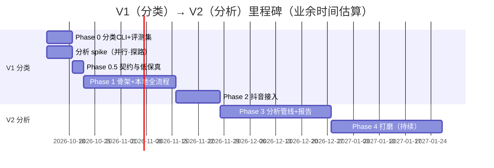

# 02 · 总体规划与里程碑

> 回答"要做哪些规划、分哪些步骤、顺序是什么"。估算按一名开发者业余时间投入；全职约可压缩到 1/2–1/3。

## 0. 版本策略与规划原则

**版本策略（2026-10-02 拍板）：V1 只做视频分类，V2 再做内容分析。**

- **V1 = 视频分类工具**：批量导入（本地 + 抖音）→ 自动打内容类型标签（分类体系可配置）→ 任务库筛选/统计。低风险快交付，解决"下载多了没法管"的素材整理问题。
- **V2 = 内容分析**：在分类库之上接转写 + 抽帧 + 分析 + 报告。最高质量风险（幻觉/要点遗漏/锚点错位）后置到 V2 集中验证。
- **防风险沉睡**：V1 开发期间并行做"分析 spike"（不随 V1 发布），V2 的最大不确定性始终在视野内。

四条原则：

1. **风险分层**：V1 只含低风险验证（分类准确率、下载稳定性、任务队列）；分析质量集中在 V2，用 spike 提前探路（V2 开工前置条件 = spike 质量结论达标）。
2. **契约先行**：V1 冻结**三个契约**——任务事件流、taxonomy 数据结构、感知层 observations schema（文档 03 §3.0）；报告 JSON Schema 冻结挪到 V2 开工前。契约冻结后界面与管线并行开发、互不返工。
3. **来源适配器隔离**：抖音风控是持续对抗型风险（今天能用明天可能失效），下载能力隔离在独立适配器后面，失败只影响"下载"这一个阶段，绝不影响本地文件链路。
4. **全云端模型**：不内置任何本地模型，ASR/OCR 全走云端 API。收益：安装包小一个量级、免模型分发与版本维护；代价：离线不可用、音频/帧需上传云端（个人工具可接受，见文档 05）。

---

## V1 · 视频分类工具

### Phase 0 · 分类内核原型（CLI）— 1 周

**目标**：最小成本验证分类准确率（V1 的核心价值）。

**内容**：
- 开工前置（已完成 2026-10-02）：百炼/智谱/火山/OSS/抖音 cookie 的 key 已备齐，统一存项目根 `.env.local`（git 忽略，模板 `.env.example`，读取规则见文档 04 §4）；TypeSafe key 在 `~/.agentguardrc` 与 `.env.local` 镜像
- Python CLI：`classify <video-file | douyin-url> [--taxonomy default.json]`（key 读取顺序：环境变量 → `.env.local`，缺失即报错）
- 串联：ffprobe → ffmpeg 抽 10 帧（均匀分布、长边 512px）→ **感知层 VLM**（qwen3-vl-flash / GLM-4.6V-Flash：输出英文观察 observations_en + 中文证据摘要）→ **决策层 Jev**（typesafe.ai Choice：taxonomy 类型 + 概率分布 + confidence）→（confidence<0.85 时）补 3×10s 音频样本转写重新判定。设计见文档 03 §3.0
- taxonomy 默认模板 v1（含各类型 hint 与 hint_en），配置驱动
- **评测集 24 个**：20 个常规形态（口播 5 / 剧情实拍 3 / 录屏教学 4 / 无解说纯字幕 3 / 多说话人 2 / 长视频 3——分类不限时长，长样本专测抽样覆盖）+ 4 个无价值对照（唱歌/舞蹈/游戏/纯音乐画面）。素材由用户自选，用现有 DouyinVideoDownloader Web 版手动下载——Phase 0 CLI 只吃本地文件，不依赖下载适配器
- **分析 spike（并行，约 1 周，不随 V1 发布）**：完整分析 CLI（云端 ASR + 关键帧 + VLM → 报告），产出 5–10 份样例报告与明确质量结论，为 V2 探路；评测集随标注持续积累

**验收标准**（含预授权分级规则，第三轮 grill 定稿）：
- 评测集 top-1 分类准确率：**≥90% 正式版；85–90% 可发布自用**（UI 标注"分类质量 beta"，人工修正回流照常积累）；**<85% 不发布**，继续打磨 hint/采样（最多 1 周，仍不行则升级手段：提高 L2 触发率、引入 embedding+LLM 级联）
- 触发 L2 的低置信样本全部正确兜底
- 实测 Jev（早期访问）定价、限流与时延，并留一组"感知层 VLM 直接分类"的基线对比数据（Jev 为默认决策层，对比仅作回归参考）；**Jev 预授权规则**：单条 >¥0.1 或 P95 >5s → 默认切"VLM 直出"、Jev 变选配；≤¥0.05 且快 → 维持默认；中间拿 A/B 数据再定（文档 03 §3.0）
- 单条分类成本 <¥0.05（VLM + Jev 合计），时延 <15s（不含 L2 轮询）
- 分析 spike 产出达标/不达标的明确结论与改进方向（不是模糊印象）

### Phase 0.5 · 设计冻结 — 2–3 天

- 冻结 V1 的三个契约：① 任务事件流事件 JSON；② taxonomy 数据结构（`[{name, name_en, worthy, hint, hint_en?}]` + 版本号）；③ 感知层 `observations_en` 半受控 schema（受控枚举标签约 20 个 + free_note 补充字段，见文档 03 §3.0）
- 任务库主界面低保真（网格 + 标签 + 筛选 + 统计，见文档 06）；UI 设计与交互产出统一使用 ui-ux-pro-max 插件（文档 06 §7）

### Phase 1 · 应用骨架 — 3–4 周

**目标**：非技术用户可独立完成"拖入 → 看分类 → 筛选"。

**内容**（按依赖顺序）：
1. Tauri 2 壳 + React 前端 + Python sidecar（FastAPI）骨架打通；PyInstaller 产出 sidecar，Tauri externalBin 拉起（文档 04 §2–3）；**第一周就出双平台空白安装包**
2. sidecar：CLI 分类管线改造为任务队列 + SQLite 持久化 + 阶段化进度事件
3. 本地文件导入（拖拽/多选/批量；按 **50–200 条/批** 设计，队列并发 3–5；同 `file_hash` 自动去重）→ 分类 → 任务库
4. 任务库主界面：缩略图网格、类型标签（悬停显示概率分布与证据摘要）、按类型/来源/有价值筛选、类型分布统计；分类详情含**感知层 10 帧预览**；CSV 导出（勾选 / 当前筛选全量）
5. taxonomy 编辑器（增删改、有价值开关、hint、恢复默认）
6. 设置：VLM/ASR provider（base_url/api_key/默认模型）、分类参数（帧数/置信度阈值）
7. 双平台打包与 ffmpeg 分发（全云端无本地模型，无模型下载步骤，文档 04 §8）
8. 首次启动引导 Onboarding（key 检测→配置向导→放行导入，见文档 06 §3.6）；批量任务最小化到托盘继续 + 完成系统通知
9. 分层测试随开发落地：纯函数单测 + provider 契约测试（fixture 回放）进 CI，评测集回归手动触发（文档 04 §7）

**验收标准**：
- 100 条混合本地文件批量分类成功率 ≥95%（不含下载失败）；中断恢复（分类中杀进程，重启续跑）
- 改 taxonomy 的有价值标记即时生效不重跑；改类型列表对后续任务生效

### Phase 2 · 抖音接入 — 1–2 周

**内容**：
- 下载适配器：**直接移植** DouyinVideoDownloader 签名核心（~1300 行无依赖 JS → Python，2–4 天；2026-10-02 确认跳过"监视文件夹"过渡方案——其过渡价值已被评测集手动采集吸收；JS 版保留作参考实现与对拍基准，文档 04 §5）
- cookie 管理 UI（粘贴 + 有效性检测 + 过期提醒）；批量链接导入
- 元数据（标题/文案/标签/BGM 名）随下载带入，作为分类证据①

**验收标准**：cookie 有效时 10 个随机链接批量下载 ≥9 成功；失败只停 downloading 阶段，不影响其他任务。

**V1 合计约 5–7 周业余时间。**

---

## V2 · 内容分析

### 前置条件

- 分析 spike 的质量结论达标；不达标先迭代提示词，不盲目开工
- **开工前决策项**：分析默认模型档（qwen3-vl-flash 省钱 vs plus 质量）——依据 spike 两档对比样例报告拍板（文档 03 §7）

### Phase 3 · 分析管线 — 3–5 周

**内容**：
1. **开工前冻结报告 JSON Schema**（文档 03 §6）与扩展后的事件契约
2. 主管线接入：云端 ASR（paraformer-v2）→ 关键帧抽取 → 分析 → 报告渲染（详细设计见文档 03 §1–§8）
3. **分析时长上限 20 分钟生效**（V1 分类不限时长；分析功能的导入校验，文档 03 §5）
4. 门控 fail-open 复活：无价值类型默认跳过分析（`no_value` 状态 + 改判按钮，语义见文档 03 §3.0）
5. 提示词模板系统（三层结构，文档 03 §4）、报告查看与导出 Markdown、内嵌播放器基础版

**验收标准**：
- 评测集 ≥80% 报告"不做修改即可采用"；JSON 结构化输出成功率 ≥95%（含一次修复重试）
- 10 分钟口播视频单条成本 <¥0.5，端到端 <10 分钟（含云端转写轮询）
- 换提示词/模型重新分析 <60s（ASR/抽帧缓存命中）

### Phase 4 · 打磨与扩展（持续）

- 报告时间锚点 → 播放器 seek；模板库（垂直模板 + 导入导出）
- 说话人分离（云端 ASR diarization）；视频直传路线（Qwen3-VL/GLM-4.6V video_url）；B 站（yt-dlp）
- 签名公证分发、自动更新

---

## 里程碑图

## 为什么是这个顺序（论证）

- **先分类（V1）后分析（V2）**：分类单独就是完整产品（素材整理），风险低、交付快；分析的质量风险最高，后置集中验证。分类管线（provider 适配、队列、taxonomy、下载适配器）100% 复用到 V2，没有抛弃成本。
- **spike 并行防沉睡**：最怕的结局是 V1 发布后停下来，V2 开工才发现报告质量不行、提示词打法全要重来——spike 用一周成本把这个不确定性保持在视野内，并成为 V2 开工的门槛条件。
- **先本地文件后抖音**：本地链路无外部对抗风险、可离线开发调试；抖音下载已有验证资产但不稳定，放后面接入可让应用先以完整形态存在（下载适配器坏，产品仍可用）。
- **契约最小冻结**：V1 只冻结事件流与 taxonomy（小而稳定）；报告 Schema 依赖 V2 的分析质量结论（例如"观点树"产出质量差就要降级为列表），过早冻结等于赌未验证的假设。
