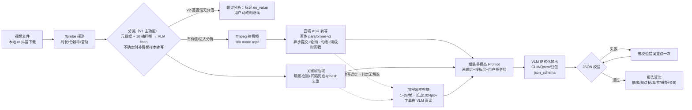

# 03 · 视频内容分析技术方案（核心）

> 回答"如何通过模型分析视频：直传 or 转文字+截图？截图按什么频率？"。调研时间 2026-10-02，模型规格/价格来自官方文档，落地前以官网为准。
>
> **架构约束（已拍板）：全云端模型，不使用本地 ASR/OCR 模型**。本地只做确定性处理（ffmpeg 抽音频/截帧/场景检测、phash 去重）。
>
> **版本边界**：§3.0 分类 = **V1 主功能**（V2 兼作价值门控）；§1–§2 分析管线、§3.1 全量 ASR、§3.3 全量抽帧、§4 分析 Prompt、§6 报告 Schema = **V2**；§5 时长上限 = V2 分析约束（V1 分类不限时长）。

## 1. 三条技术路线对比

| | A. 混合管线（云端 ASR + 关键帧 → VLM） | B. 视频直传 API | C. 纯文本（只 ASR，无帧） |
|---|---|---|---|
| 语音信息 | ✅ 云端 ASR 转写，完整 | ⚠️ **国内 API 基本丢失**（见下） | ✅ |
| 画面信息 | ✅ 关键帧级（无连续动作） | ✅ 最好（可看动态） | ❌ |
| 成本/上下文 | ✅ 可控（帧数、分辨率自主） | ⚠️ 随时长线性涨，需调采样 fps | ✅ 最省 |
| 长视频 | ✅ 分段可控 | ⚠️ 受上下文限制 | ✅ |
| 实现复杂度 | 中（一次云端转写调用+轮询） | 低（一个 API 调用） | 低 |

### 关键事实（决定路线的两个发现）

1. **国内可直传视频的 API 不理解视频里的音频**。阿里百炼文档明确：Qwen3-VL 系列"不支持理解视频中的音频"；豆包 Doubao-Seed-1.6-vision、智谱 GLM-4.6V 的视频输入均为画面帧采样，文档均未提及音频参与理解。音画联合理解的只有 Google Gemini（音轨 32 token/秒参与理解），但国内访问与付费有障碍。**抖音内容以口播为主，语音才是主要信息载体**——所以混合管线不是"省钱妥协"，而是国内条件下的必选路线。
2. **直传路线的 token 消耗随采样帧数线性增长**。Qwen3-VL 采样 fps 默认 2.0（每 0.5s 一帧）、可调 0.1–10，每帧上限约 640 token（plus 档 VIDEO_MAX_PIXELS 配置）：10 分钟视频按默认 fps ≈ 1200 帧 × 640 ≈ 768K token，**超出 256K 上下文**，必须降 fps 到 0.5 以下才放得下。混合管线自己控制帧数（10 分钟 60–150 帧），成本和上下文占用都更可控。

**结论**：V1 默认路线 A（口播/会议/教程等语言主导内容），可选路线 C（极度省流或纯音频）；路线 B 作为 V1.5 可选项（画面前提类：实拍/Vlog/运镜类），走 Qwen3-VL `video_url` 或 GLM-4.6V/GLM-5.3-Flash。

## 2. 混合管线（路线 A）总体结构



各阶段产物全部按 `文件hash + 阶段版本` 缓存：换提示词重新分析不重跑 ASR/抽帧。

## 3. 各环节设计

### 3.0 分类（V1 主功能，V2 兼作价值门控）

抖音内容形态多样（口播/访谈/解说/唱歌/舞蹈/游戏/剧情…），其中唱跳、游戏操作类没有内容分析价值。本节的分类能力有双重身份：

- **V1：分类就是主功能**——每条视频都产出分类结果（类型/概率分布/置信度/证据摘要），taxonomy 的"有价值"标记仅作筛选标签（如默认过滤唱跳类），没有中断语义；
- **V2：兼作分析管线的价值门控**——高置信落到无价值类型的视频在转写与全量抽帧**之前**中断，省掉 ASR 轮询与多模态大请求的等待和费用（fail-open 语义见下）。

**分类规则按"信息载体"表述而非穷举类型**（可泛化到未列举的形态）：内容主要由**语音、内嵌字幕或画面文字**承载（口播、访谈、解说、教学、录屏、带解说剧情）= 有价值；主要由**旋律、动作、画面氛围**承载（唱歌、舞蹈、游戏操作、纯风景/宠物混剪）= 无价值。

准确分类需要**三类互补证据**（按获取成本递增）：

| 证据 | 获取方式 | 成本 | 能区分什么 |
|---|---|---|---|
| ① 平台元数据：标题/文案/话题标签/**BGM 音乐名**/时长/作者 | 抖音来源：下载接口自带 desc 等字段；本地文件无此证据 | 免费 | 最强先验：#翻唱/#舞蹈/#游戏 vs #干货/#科普；口播 BGM 多为"原声"，唱跳多挂热门音乐 |
| ② 视觉抽样：10 帧均匀分布（覆盖开头/中段/结尾），长边 512px | ffmpeg 按时间点截帧 | ≈¥0.002 | 舞蹈（全身动作/舞台）、游戏（HUD/操作界面）、口播（人物面对镜头+底部字幕条）、录屏（桌面/代码） |
| ③ 音频样本转写：3 段×10s（约 10%/50%/90% 位置）拼接上传云端 ASR | ffmpeg 截段拼接 → paraformer-v2 | ≈¥0.002 + 一次轮询 | 唱歌（歌词/哼唱→识别为歌词或乱码）vs 口播（连贯自然语句）；游戏有无解说；纯音乐（转写为空） |

**画面证据有两个盲区**：唱歌 vs 口播构图几乎相同（人对镜头、嘴在动）、游戏有无解说画面都是 HUD——这两类只能靠音频样本区分。

**分类决策采用"VLM 感知 + Jev 决策"两层（2026-10-02 拍板：决策用 typesafe.ai 的 Jev）**。

Jev 是 TypeSafe AI 的 System One 决策模型：输入结构化问题（state + instructions + criteria），返回类型化判断而非自由文本。**Choice 原语天然匹配分类**——选项即 taxonomy 类型（单题最多 255 个选项，官方建议带"其他"兜底），输出**完整概率分布 + confidence**；非自回归、响应快、多问题并行几乎不增加时延；不生成解释文本，从机制上杜绝"编理由"。两个官方文档确认的约束与对策：

- **Jev 只收文本**（"Images, audio, and video are not supported (yet)"）→ 视觉证据必须先经 VLM 转写为文本事实
- **中文准确率较低**（CJK "currently have lower accuracy"）→ 由 VLM 做中英桥接，**发给 Jev 的 state 与 criteria 全部用英文**

**分类体系（taxonomy）可配置，且"决策层判类型、配置判价值"分离**：

- 分类体系是用户配置数据：`[{name, name_en, worthy, hint, hint_en?}]`。**`name_en` 是稳定键**（第三轮 grill 定稿）：Jev Choice 的选项名、SQLite/CSV/标注样本库存储的 type 一律用 `name_en`；中文 `name` 仅 UI 显示——用户日后改中文显示名不会导致历史数据失配。内置默认 **11 类（2026-10-02 定稿）**：口播 monologue✓（纯观点/知识/故事分享，不含卖货）· **带货口播 sales_pitch✓**（人物对镜头推销商品，画面常有商品特写/价格字幕/购物车引导）· 访谈 interview✓ · 解说 commentary✓（**优先级规则：有解说的游戏、影视归"解说"**，画面是什么不决定归属）· 教学·录屏 tutorial✓ · 剧情 drama✓（无解说的剧情/实拍）· 唱歌 singing✗ · 舞蹈 dance✗ · 游戏 gameplay✗（无解说或解说非内容主体的游戏画面）· 纯音乐画面 music_visual✗ · 其他 other✓，设置页可增删改；自定义类型 `name_en` 留空则回退用中文（Jev 能收但精度降，UI 提示）
- **单选归类 + hint 优先级规则处理复合形态**（游戏解说→解说、带货讲解→带货口播）；数据结构预留 `types[]` 字段，V2 如需多标签用 Jev 多 Noul（每类型一个是否判断）升级
- `hint`（中文，UI 展示与感知层参考）与 `hint_en`（英文，作为 Jev Choice 的 criteria 描述）分离：内置类型两者自带；自定义类型 `hint_en` 留空则回退用中文 hint（Jev 能收中文但精度降低，UI 提示"英文描述效果更佳"）
- **决策层只判类型**：输出 `choice + probabilities + confidence`；`analysis_worthy` 由应用层按配置映射（type → worthy）——**改"某类型是否有价值"的标记不需要重新调模型**，只有增删类型或改 hint 才重跑分类（缓存键含 taxonomy 版本号）
- 列表外兜底：Jev 选项里带"其他"（官方推荐）；`other_guess` 由感知层 VLM 给出——用户漏配的新形态可从 other_guess 聚类里发现，反哺完善分类体系
- 系统层固定不随配置变：信息载体判定原则、fail open 决策、置信度阈值 0.85（高级设置可调）

1. **感知层（flash 档 VLM：qwen3-vl-flash / GLM-4.6V-Flash）**：输入元数据 + 10 帧（低置信时附音频样本转写），输出结构化**英文观察** `observations_en`（如 person-facing-camera / hud-ui-present / subtitle-bar-embedded / stage-fullbody-dance / product-closeup / conversational-speech / lyrics-like-text / no-speech…）+ 一句中文证据摘要 `summary_zh`（供 UI 展示）+ `other_guess`（列表外形态的自由猜测）。只陈述观察到的事实，**不做最终分类**
2. **决策层（Jev，typesafe.ai）**：state = `observations_en` + 时长等数字字段（全英文）；questions = Choice `video_type`（**选项名 = 各类型的 `name_en`**，criteria ← `hint_en`）+（可选）Noul `speech_or_text_driven`（内容是否主要由语音/字幕/画面文字驱动）。输出 `choice + probabilities + confidence`
3. **L2（Jev confidence <0.85 时自动触发）**：补采 3×10s 音频样本转写 → 感知层把转写归纳为英文语音风格观察（歌词/解说/纯音乐）→ 重新决策。L2 任务在队列中**异步执行、不阻塞其他条目出结果**（预估触发率 <15%）；设置页"快速模式"可关闭 L2（本地文件无元数据，直接依赖 帧+音频样本 两路）
4. **决策规则（fail open，V2 语义）**：type 按配置映射有价值，或 confidence 不足 → 放行分析；仅高置信落到"无价值类型"才中断（no_value 可改判）。Jev 的 confidence 即概率分布集中度，与阈值语义直接对应；**概率分布整体进 UI**（比一句"理由"信息量大）。误杀代价（丢报告+信任）>> 错放代价（几毛钱与几分钟）

**`observations_en` 半受控 schema（D51，Phase 0.5 一并冻结）**：感知层输出不是自由散文，而是"受控枚举标签（可多选）+ 自由文本补充"——枚举标签 v1 约 20 个（person-facing-camera / multiple-speakers / hud-ui-game / stage-fullbody-dance / subtitle-bar-embedded / product-closeup / text-heavy-slide / conversational-speech / lyrics-like / no-speech / outdoor-scenery / cinematic-edit / talking-head-with-broll …清单在 Phase 0 打磨定稿），外加一个 `free_note` 字段兜底未覆盖形态。受控词表保证 Jev 看到的 state 表达稳定不漂移；**V1 契约由此从两个变三个：任务事件流、taxonomy 结构、observations schema**。

Jev 处于早期访问期（2026-10 发布），定价/限流未公开——**Phase 0 实测成本与时延**，并已预授权决策规则（免得届时再议）：实测**单条 >¥0.1 或 P95 时延 >5s → 默认决策层切换为"VLM 直出"，Jev 降为设置里的可选项**（恢复便宜后可切回）；**≤¥0.05 且快 → 维持 Jev 默认**；中间地带（¥0.05–0.1）拿 A/B 准确率对比数据再定。决策层做成可切换 provider，typesafe.ai 不可用或成本异常时**自动降级为"感知层 VLM 直接分类"，并在结果上标记"降级判定（VLM 直出）"**（设置可改为"仅报错"），保证分类链路永不单点阻塞、且结果口径透明可追溯。

**备选与级联（中文友好的替代决策方案，2026-10-02 调研）**：

| 档位 | 方案 | 中文能力 | 形态 | 成本/条 | 取舍 |
|---|---|---|---|---|---|
| 降级/基线 | **qwen3-vl-flash 直接分类**（感知决策合一） | 原生中文+多模态，无需英文桥接 | chat + json_schema，自报概率分布 | ≈¥0.002 | 最实用；概率校准性与"不自报理由"不如 Jev；GLM-4.6V-Flash 同理且免费 |
| 可选 L0 | **embedding/重排零样本分类**：text-embedding-v4（Qwen3 训练，MTEB 中英强）或 qwen3-rerank，证据摘要 vs 各类型描述 → 相似度/排序分 → softmax 分布 | 原生中文 | 向量/重排 API（百炼，同账号） | ≈几厘（¥0.0005/千token） | 极便宜、无自由文本、天然输出分布；只吃文本（视觉仍需感知层）；细粒度对立判别（唱歌 vs 口播）弱于推理；softmax 校准粗糙，阈值需自标定 |
| 参考 | 通用 LLM+结构化输出（国际） | 可用但有访问/付费障碍 | — | — | OpenAI 旧 Classifications API 已于 2023 废弃，国际侧同样以"通用模型+结构化输出"为主；**国内未发现 Jev 同类的"类型化判断"专用模型服务** |

级联建议：L0 embedding 便宜闸门（标签/标题直命中的明确样本，Phase 1.5 实验性引入）→ L1 感知+Jev 决策（默认）→ 降级 qwen3-vl-flash 直接分类。Phase 0 的 A/B 基线（Jev vs qwen 直接分类）数据将直接回答 Jev 的增益是否值得承担早期访问风险。

门控结果按 `file_hash + taxonomy 版本` 缓存；改 worthy 标记即时生效不重跑，改类型列表（含 hint）才重跑；改判/重新分析不重跑门控。

验收：**V1（分类主功能）** 评测集 top-1 准确率 ≥90%，触发 L2 的低置信样本全部正确兜底；**V2（门控语义）** 有价值样本误杀率 = 0（不确定一律放行），无价值对照样本（唱歌/舞蹈/游戏/纯音乐 各 1）拦截率 ≥80%。

### 3.1 音频与云端 ASR

- 抽取：`ffmpeg -i in.mp4 -vn -ac 1 -ar 16000 -b:a 64k out.mp3`（16kHz 单声道 mp3：10 分钟约 5MB 上传体积小、各家通用；注意百炼说话人分离硬性要求单声道）
- **默认：阿里百炼 paraformer-v2**。理由：
  - **¥0.288/小时全场最低**，且每月赠 10 小时免费额度（约覆盖 60 条 10 分钟视频）
  - 句级+词级时间戳固定开启；`diarization_enabled` 说话人分离（单声道，返回 speaker_id）
  - 单文件 ≤2GB / 时长 ≤12 小时，完全覆盖需求；支持 mp3/wav/aac 等主流格式
  - 与默认 VLM qwen3-vl-flash **同一百炼账号同一 API Key**，零额外配置
  - 调用为异步：提交任务 → 2–5 秒间隔轮询（或回调），10 分钟音频通常数十秒到数分钟出结果
  - **注意：异步接口只收公网 URL**。个人工具直接用百炼"文件上传"临时存储生成临时 URL（48h 有效；官方标注不建议生产、限流 100 QPS，个人量级够用）。**OSS V1 默认不启用**（第三轮 grill 定稿：`.env.local` 里的 OSS 字段保留但配置页默认关闭，仅当临时存储反复失败时手动开启；且现有 AK/SK 指向团队测试桶，个人项目默认不写团队资源，将来需要时开个人桶替换）
- 备选：**火山引擎 Seed-ASR 2.0**（`volc.seedasr.auc`，¥0.8/小时，字级时间戳+说话人分离+热词/PPT 上下文增强）；其**极速版**（≤100MB / ≤2h）支持**直传二进制、同步返回**，适合不愿配置 URL 存储的场景（资源包约 ¥2.3/小时，略贵）。讯飞（¥4.9–9.9/小时）与 OpenAI（$0.006/分钟 + 大陆访问/付费障碍）不作默认。
- **不采用**：GLM-ASR-2512——单次 ≤30 秒、≤25MB 且**不返回时间戳**（长视频需自行切 30s 分片再拼接时间轴，工程上得不偿失），仅适合做"短语翻译/校对"类辅助。
- 输出统一为**句级时间戳**：`[{text, start, end, speaker?}]`，这是全应用唯一的权威时间轴。
- ASR provider 与 VLM 同层的可替换适配器（文档 04 §4），输入模式（URL/二进制）与同步/异步语义由 provider 能力声明消化，切换成本≈改设置。

### 3.2 内嵌字幕：不做独立 OCR，由 VLM 直读关键帧

抖音大量视频"字幕烧在画面里"，其中一部分甚至**无人声只有 BGM+字幕**。既然字幕本来就呈现在关键帧图像里，**视觉模型可以直接读出来，不需要独立 OCR 服务/模型**：

- **触发判定**：转写字数/时长比低于阈值（如 < 5 字/分钟）判定"无解说" → 采样间隔降到 1–2s，帧长边提高到 1024–1280px 保证小字号字幕可读
- **Prompt 配合**：系统层追加指令"画面中有内嵌字幕时，按时间顺序整理为字幕轨，作为内容来源之一"
- **收益**：砍掉一个模型依赖和一个处理阶段，管线更短，与全云端架构一致
- **局限与取舍**：花字/竖排/贴纸遮挡的字幕可能漏读错读——这是用"读图"换"OCR 精度"的取舍，靠评测集回归监控（含 3 个纯字幕样本）；若实测不达标，再引入云端 OCR API 作为后备步骤（analyzer 接口已预留扩展位）

### 3.3 关键帧抽取（回答"按什么频率截图"）

**不要用固定 1fps**（10 分钟 = 600 帧，token 爆炸且大量近重复帧；口播视频画面几乎不变）。采用四层策略：

1. **场景切分**：PySceneDetect ContentDetector（或 `ffmpeg -vf "select='gt(scene,0.35)',showinfo"` 一档够用），每个镜头取**首帧**作为代表帧
2. **最大间隔兜底**：两个相邻关键帧间隔超过上限时强制补帧，保证信息覆盖
3. **phash 去重**：imagehash 计算 64 位感知哈希，汉明距离 ≤10 视为近重复帧丢弃（快切、闪光导致的误报由此消化）
4. **总量上限**：默认 150 帧；超限按时间均匀抽稀（20 分钟口播视频按 5s 兜底会产生约 240 帧候选，抽稀后仍均匀覆盖全程；模型选 GLM-4.6V 时上限可降至 120，见 §5）

**兜底间隔按内容类型**（探测阶段用分辨率/场景密度/ASR 密度粗分类，用户可改）：

| 内容类型 | 兜底间隔 | 预期帧数（10 分钟） | 说明 |
|---|---|---|---|
| 口播/访谈 | 5s | 60–120 | 信息在语音，画面只用于锚点与图表 |
| Vlog/剧情实拍 | 3s | 100–200 | 镜头切换多，场景检测为主 |
| 录屏/教学/PPT | 10s + 场景帧 | 30–80 | 画面文字密集，帧可更大分辨率 |
| 会议录像 | 15s 或仅转写 | <40 | 共享屏幕变化时才有信息 |
| 无解说纯字幕 | 1–2s + 长边 1024–1280px | VLM 直读字幕 | 转写近空时自动触发 |

**帧规格**：长边 768px、JPEG 质量 75。Qwen3-VL 按 32×32px/token 计（768×432 ≈ 324 token/帧），并可用 API 的 `max_pixels` 参数压单帧成本；该分辨率对"看清画面文字与构图"与 token 成本的平衡最佳。**每帧带时间标签**（文件名 `frame_0035.jpg` + Prompt 内 `[t=00:35]`），供模型生成章节/观点的时间锚点。

## 4. Prompt 设计（自定义提示词的承载方式）

三层解耦，保证"用户随便写指令，报告结构仍稳定可渲染"：

```
┌ 系统层（固定，代码内置）
│   角色："视频内容分析师"；输入说明（时间戳转写/带时间标签的帧/OCR字幕）
│   引用规则："任何结论必须给出 time 或 frame 引用；转写中没有的信息不得编造"
│   输出：严格遵循给定的 JSON Schema（结构化输出）
├ 模板层（内置+用户模板，可选）
│   分析侧重与输出口吻，如：会议纪要 / 知识点提取 / 带货话术拆解 / 求真核查 / 二创脚本
└ 用户指令层（本次分析的自由文本）
    "重点看他对XX的观点，列出可执行的步骤"
```

变量：`{{transcript}}`（句级时间戳转写）、`{{subtitles}}`（OCR 字幕，可空）、`{{frames}}`（带时间标签的关键帧序列）、`{{metadata}}`（时长/来源/标题）、`{{user_instructions}}`。

多帧输入注意：GLM-4.6V 单请求**不能同时传"视频+图片+文件"混合模态**（纯图片序列+文本没问题，混合管线不受影响）；Qwen 单请求最多 512 张图/64 个视频，帧数在限额内。

## 5. 时长上限与长内容处理

**分析功能的硬性上限（V2 生效）：20 分钟**。V1 分类不限时长（抽 10 帧对任意时长均可行，素材库里的长视频照样分类）；V2 分析在导入时 ffprobe 校验，超出直接拒绝并明确提示（fail fast，不进任务队列、不消耗额度）。

该上限的技术依据：20 分钟口播视频在混合管线下约 100–110K input token（帧总量上限 150 + 全量转写约 10K token），qwen3-vl（256K 上下文）/ GLM-5.3-Flash（1M）可单请求完整处理；GLM-4.6V（128K）也可容纳，偏紧时把帧上限降到 120。云端 ASR 侧更无压力（paraformer-v2 上限 12 小时）。

**因此 V1 不需要 map-reduce 分段**，管线少一个层级。若未来放宽上限（如 60 分钟会议录像），扩展方案预留如下，V1 不实现：按转写静音 + 场景边界切 ≤12 分钟段（段间 30s 重叠）→ 每段独立分析（map）→ 合并摘要/观点/章节并统一时间轴（reduce）。

## 6. 报告 JSON Schema（界面渲染契约，Phase 0.5 冻结）

```json
{
  "title": "string, 视频标题/主题（可自动生成）",
  "summary": "string, 150–300字摘要",
  "chapters": [
    {"title": "string", "start": 0, "end": 120, "summary": "string"}
  ],
  "viewpoints": [
    {"topic": "string", "claims": [{"text": "string", "time": 35, "frame": 12}]}
  ],
  "todos":   [{"text": "string", "time": 180, "context": "string"}],
  "quotes":  [{"text": "string 原话", "time": 95}],
  "entities": ["人物/品牌/产品"],
  "qa":      [{"q": "string", "a": "string"}],
  "meta": {"model": "string", "template": "string", "duration": 621}
}
```

结构化输出：智谱/百炼/方舟/Gemini/OpenAI/Claude 均已支持 `json_object` / `json_schema`（严格模式）。流程：请求带 schema → 本地 JSON Schema 校验 → 失败则把校验错误拼进消息重试一次 → 仍失败**按阶段报错**（fail fast，不吞异常，任务标记 analyzing_failed 可重试）。

## 7. 成本与时延估算（10 分钟口播视频，路线 A）

输入构成：转写约 4–6K token + 帧按 80 帧×600token≈48K + 模板/指令 2K ≈ **55K input / 3K output**。

| 配置 | 输入单价(元/M token) | 单视频成本估算 | 备注 |
|---|---|---|---|
| GLM-4.6V-Flash | 免费 | ¥0 | 开发期主力，限量以官网为准 |
| qwen3-vl-flash | 0.15（>32K 档翻倍） | ≈ ¥0.03–0.06 | 有 100 万 token 免费额度 |
| qwen3-vl-plus | 1.0 / >32K 1.5 | ≈ ¥0.1–0.2 | 质量档 |
| GLM-4.6V | 1.0（>32K 档 2.0） | ≈ ¥0.1–0.2 | |
| doubao-seed-1.6-vision | 0.8 | ≈ ¥0.05–0.1 | 视频传入限制文档不透明，需实测 |
| 云端 ASR paraformer-v2（每条必发生） | ¥0.288/小时 | 10 分钟 ≈ ¥0.05 | 每月赠 10 小时；备选火山 Seed-ASR 2.0 ¥0.8/小时 |
| 分类/门控（V1 每条必发生；V2 兼作门控） | 感知 flash 档 + Jev 决策 | VLM ≈ ¥0.002–0.02 + Jev 待实测 | 10 帧 + 元数据；L2 补 30s 音频样本转写另加 ≈¥0.002；Jev 早期访问定价未公开，Phase 0 实测 |
| 对照：路线 B 直传 qwen3-vl-flash（fps=0.5） | — | ≈ ¥0.1–0.15 | 且丢音轨 |
| 对照：Gemini 2.5 Flash 低分辨率直传（~100 tok/s） | $0.30 | ≈ ¥0.15 | 音画齐解，需国际网络 |

结论：**API 成本可忽略（ASR + VLM 合计 <¥0.5/条）**——20 分钟上限内的最坏情况（口播 150 帧 + 全量转写，~110K input）用 qwen3-vl-flash 仍 <¥0.1、plus <¥0.3。真正的开销在等待上：云端 ASR 异步轮询通常 30 秒到数分钟，多模态生成 30–90s。价格来源见文末链接，以官网实时价为准。

## 8. 评测集与迭代（Phase 0 的核心交付）

- 20 个视频固定为评测集（构成见文档 02 Phase 0），每次改提示词/采样参数全量回归
- **分类回归报告（V1，固定输出形态）**：top-1 准确率、**每类 precision/recall、混淆矩阵**、错例清单（附 confidence 分布）、L2 触发率、other_guess 聚类统计——达不达标一眼可见，弱项直接指向该打磨的 hint（D52）
- 评分表（1–5 分 × 4 维度，V2 分析用）：完整性（要点无遗漏）/ 准确性（无幻觉、转写正确归因）/ 锚点准确率（抽 10 个 time 随机人工核对）/ 可用性（报告无需修改即可用）
- 提示词模板纳入版本管理，评测结果记录在案
- **人工修正回流**：UI 手动改类型（文档 06）自动累积为**人工标注样本库**——**键按来源取**：抖音用 `aweme_id`、本地文件用 `file_hash`（抖音重下载/换画质会改变文件 hash，aweme_id 才稳定，D50）；值 = 修正后类型 + 当时的 observations_en。taxonomy 变更、提示词或采样参数迭代的回归**优先跑人工标注集**。评测集从初始 24 个随日常使用持续增长，这是分类准确率长期改进的核心飞轮

## 9. 来源（查询于 2026-10-02）

- 智谱模型总览/定价/GLM-4.6V/GLM-4.5V/结构化输出：docs.bigmodel.cn（/cn/guide/start/model-overview、/cn/guide/start/pricing、/cn/guide/models/vlm/glm-4.6v.md、/cn/guide/models/vlm/glm-4.5v、/cn/guide/capabilities/struct-output）
- 阿里百炼视觉理解/定价/结构化输出：help.aliyun.com（/zh/model-studio/vision、/zh/model-studio/model-pricing、/zh/model-studio/qwen-structured-output）
- 火山方舟视频理解/定价：docs.volcengine.com（/docs/ark/video-understanding、/docs/82379/1099320）
- Gemini 视频理解/定价：ai.google.dev（/gemini-api/docs/video-understanding、/gemini-api/docs/pricing）
- OpenAI 不支持原生视频：community.openai.com/t/1392430；Claude 仅图像/PDF：platform.claude.com/docs/en/build-with-claude/vision
- 本地处理工具（仍使用）：PySceneDetect：github.com/Breakthrough/PySceneDetect；imagehash：github.com/JohannesBuchner/imagehash
- 已放弃的本地模型方案来源（备查，全云端决策前的对比项）：sherpa-onnx：github.com/k2-fsa/sherpa-onnx；SenseVoice：github.com/FunAudioLLM/SenseVoice；RapidOCR：github.com/RapidAI/RapidOCR；faster-whisper Metal 限制：github.com/SYSTRAN/faster-whisper/issues/911；pyannote 商用限制：huggingface.co/pyannote/speaker-diarization-3.1
- 云端 ASR（全云端方案采用）：百炼 paraformer-v2 HTTP API 与使用指南：help.aliyun.com/zh/model-studio/paraformer-recorded-speech-recognition-restful-api、/zh/model-studio/non-realtime-speech-recognition-user-guide、/zh/model-studio/model-pricing；火山大模型录音文件识别（标准版/极速版/计费）：docs.volcengine.com（DoubaoVoice 分类）；智谱 GLM-ASR 30 秒限制与无时间戳：docs.bigmodel.cn/api-reference/模型-api/语音转文本
- Jev / TypeSafe AI：docs.typesafe.ai（/concepts/state.md——"Jev accepts text only, images/audio/video not supported (yet)"、CJK lower accuracy；/primitives/choice.md——Choice 原语/255 选项上限/概率分布+confidence/其他兜底建议）；发布介绍：typesafe.ai/blog/introducing-system-one-models-and-jev、infoq.com/news/2026/10/typesafe-ai-jev-released
