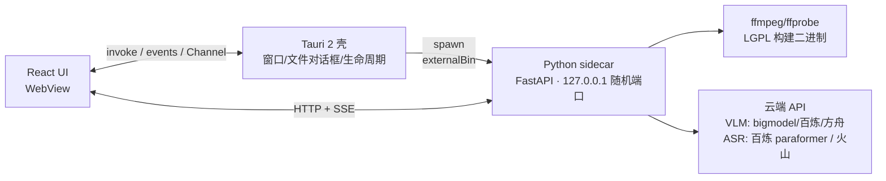

# 04 · 技术架构与选型

> 桌面端（Windows + macOS）整体架构。调研时间 2026-10-02，来源见文末。

## 1. 选型结论：Tauri 2 + React + Python sidecar + ffmpeg

| 选项 | 结论 | 理由 |
|---|---|---|
| **Tauri 2**（壳，2026-10-02 用户确认） | ✅ 采用 | 壳仅数 MB、内存约为 Electron 的 1/2–1/4；官方 sidecar 机制明确支持 PyInstaller 产物；本项目体积大头在 sidecar/ffmpeg，没必要再背 120–200MB 的 Chromium |
| Electron | 备选 | 生态成熟（Cherry Studio/Chatbox 均用），但 Node 运行时在本项目用不上——管线编排与云端 API 调用在 Python sidecar，前端只是播放+渲染报告 |
| Flutter/Qt | 排除 | AI 工具生态与可参考先例少 |

参考先例：Jan（桌面 AI 应用，从 Electron+Nitro sidecar 迁到 Tauri）、Cap（Tauri 2 + ffmpeg 的视频应用）、taurscribe（Tauri + FastAPI Python sidecar 做转写）。

## 2. 进程与通信



- sidecar 用 PyInstaller 打包成独立可执行文件，Tauri `bundle.externalBin` 声明（文件名带 target-triple 后缀），启动后轮询 `/health` 握手，应用退出时 kill
- **sidecar 本地 HTTP 加一次性 token 握手（D54）**：启动时生成随机 token 经 Tauri 注入前端，所有请求必须携带、不匹配即 401——随机端口 + 仅 127.0.0.1 + token，三重防本机其他进程扫到端口后误访（删任务/读库）
- 选本地 HTTP 而非 stdio JSON 协议：长耗时多阶段任务需要结构化请求/进度查询/并发管理/中途取消，HTTP+SSE 省去自定义分包转义协议
- 前端播放本地视频走 Tauri asset/自定义协议把文件路径暴露给 WebView；报告渲染用 react-markdown

## 3. sidecar 模块划分（Python）

```
sidecar/
  api/          # FastAPI 路由：任务 CRUD、设置、模板、SSE 事件流
  queue/        # 任务队列（单机串行+优先级）、状态机、阶段重试、断点续跑
  media/        # ffprobe/ffmpeg 封装：抽音频、按时间戳截帧、场景检测、（V2）分析时长校验
  asr/          # 云端 ASR 适配：V1 仅分类 L2 音频样本转写；V2 主管线转写（paraformer-v2 提交/轮询、说话人分离、无解说判定）
  frames/       # phash 去重、分辨率压缩、帧清单管理
  classify/     # 分类：感知层 VLM（中英桥接→observations_en）+ 决策层 Jev（Choice）+ worthy 映射 + L2 音频样本补证
  analyzer/     # （V2）分析 Prompt 组装、provider 适配、json_schema 校验与重试
  providers/    # 模型接入层（见 §4）
  download/     # 抖音下载适配器（见 §5）
  store/        # SQLite：任务/产物缓存/报告/模板/设置
```

## 4. 模型接入层

- 智谱 bigmodel、阿里百炼、火山方舟均提供 **OpenAI 兼容端点**，统一用一个兼容 client + 每家 provider 配置（`base_url`、`api_key`、`model`、`extra_headers`）。**base_url 等一律进设置存储，禁止硬编码**。
- **TypeSafe（typesafe.ai / Jev）是另一类 provider**：API 形态不是 chat-completions，而是 `state + questions → 类型化判断`（Choice/Noul/Score，见文档 03 §3.0）。provider 层分两类接口——`chat`（VLM/ASR，OpenAI 兼容）与 `decision`（Jev）；分类决策层走 decision 接口，可整体切换降级为"感知层 VLM 直接分类"（typesafe.ai 不可用/成本异常时的兜底）。
- **Key 的读取来源（2026-10-02 定稿）**：所有平台密钥统一存**项目根 `.env.local`**（dotenv 格式，已建，git 忽略、文件权限 600；字段模板见可提交的 `.env.example`：DASHSCOPE_API_KEY / TYPESAFE_API_KEY / ZHIPU_API_KEY / ARK_API_KEY / OSS_* / DOUYIN_COOKIE）。Phase 0 CLI 读取顺序：**环境变量 → `.env.local`**；TYPESAFE_API_KEY 主源仍为 `~/.agentguardrc`（`.env.local` 内为镜像）。任一必需 key 缺失即启动报错（fail fast，不吞）。桌面应用正式版以设置页录入 + 系统 keychain 存储为主（含"从 `~/.agentguardrc` / `.env.local` 导入"便捷项）。密钥一律不硬编码、不写日志、不进文档与 git。
- **额度与用量（已定）**：百炼免费额度用尽后**自动按量续费**（L2 单条 <¥0.1，绝对金额极小）；设置页显示本月各服务用量与花费估算；**月度预算提醒线默认 ¥20**（可调可关，触发只提醒一次、不阻断任务）。
- 能力差异用 provider 描述声明（是否支持 json_schema 严格模式、单请求图片上限、视频直传），analyzer 按 capability 降级（严格 schema → json_object + 本地校验）。
- ASR 同层接入：provider 声明输入模式（公网 URL / 直传二进制）与同步/异步语义；百炼临时上传与 OSS 直传在 provider 内部实现，对外统一接口 `transcribe(audio_path) -> sentences[]`。
- API Key 仅存本地（系统 keychain 优先：macOS Keychain / Windows Credential Manager，Tauri 有插件），导出/同步功能永不包含密钥。

## 5. 抖音下载集成

现状资产：`/Users/yiqi/webProjects/DouyinVideoDownloader`（Node + Fastify，签名核心 `lib/` 约 1300 行无依赖 JS：abogus.js 363 / api.js 400 / sm3.js 94 / websign.js 68 / linkParser）。

| 方案 | 说明 | 取舍 |
|---|---|---|
| **A. 移植签名核心到 Python（2026-10-02 确认采用）** | 1300 行纯 JS 无依赖，移植+对拍验证约 2–4 天；单运行时、打包简单 | 一次性成本；后续抖音协议变更时双处维护（保留 JS 版为参考实现，以对拍测试保证一致） |
| B. 监视文件夹（已否决） | 用户用现有 Web 应用下载到约定目录，App 自动导入 | 过渡价值已被"评测集手动采集"吸收，体验割裂，直接跳过 |
| C. 双 sidecar（Node+Python） | 打包 Node 运行时，体积+30MB+，进程管理复杂 | 排除 |

**cookie 获取优化路径**（当前手工配置是主要摩擦点）：
1. V1：设置页粘贴 cookie 字符串 + 调用方舟/抖音接口做**有效性检测**，失效时任务停在 downloading 并明确提示
2. V2 调研：App 内嵌 WebView 加载抖音网页版扫码登录后读取 cookie（合规性自查）；或本地代理引导式抓取。协议细节（a_bogu 签名变更等）预期会持续变化，download 模块接口按"可整体替换"设计，测试隔离。

## 6. 数据模型（SQLite）

```
tasks(id, source_type[local|douyin], source_url, file_path, file_hash, status, stage,
      error_stage, error_msg, created_at, updated_at,
      source_meta)   -- source_meta JSON：抖音来源存 aweme_id/desc/hashtags/music/author/duration（分类证据①与 CSV 依赖，D49）；本地文件为空
artifacts(task_id, stage[classify|transcript|frames], version, payload_json)   -- 缓存键: file_hash+stage+version（classify 阶段 version=taxonomy 版本）
reports(id, task_id, template_id, model, prompt_snapshot, report_json, markdown, created_at)
templates(id, name, builtin, system_layer, user_layer, variables_json, updated_at)
settings(key, value)   -- provider 配置（VLM/ASR chat 类 + TypeSafe decision 类各自的 base_url/api_key/默认模型）、采样参数、下载器 cookie 引用、门控分类体系 taxonomy（JSON: [{name, name_en, worthy, hint, hint_en}] + 版本号；name_en 为稳定键）等
```

- 换提示词/换模型重新分析：transcript/frames/ocr 缓存直接命中，仅重跑 analyzer（<60s）
- 中断恢复：任务状态机持久化，重启后已完成阶段跳过

**任务状态机**：

```mermaid
stateDiagram-v2
    [*] --> created
    created --> downloading: 抖音来源
    created --> probing: 本地文件
    downloading --> probing
    probing --> classifying
    classifying --> classified: V1 终态
    classifying --> extracting: V2·有价值类型
    classifying --> no_value: V2·高置信无价值
    no_value --> extracting: 用户改判·继续
    extracting --> transcribing --> sampling --> analyzing --> done
    probing --> rejected: 超20min(仅V2分析)
    downloading --> cancelled: 用户主动取消
    classifying --> cancelled: 用户主动取消
    downloading --> failed: 可重试(仅本阶段)
    classifying --> failed
    analyzing --> failed
    failed --> classifying: 阶段重试
    done --> analyzing: 重新分析(缓存命中)
```

状态说明：`classifying`（分类，见文档 03 §3.0）失败可重试，结果缓存键含 taxonomy 版本；**V1 终态是 `classified`**——分类即产品，无后续管线、无中断语义；`no_value`、`rejected` 与 extracting 之后的链路均为 **V2 分析**语义（no_value 是主动中断而非失败，可改判后继续；20 分钟上限仅约束 V2 分析，V1 分类不限时长）；**`cancelled` 是用户主动取消的终态**——进行中阶段优雅停止（杀 ffmpeg 子进程/中断轮询），已完成阶段的缓存保留，可从"重新分类/继续"复活任务。

事件契约（SSE，Phase 0.5 冻结）：`stage_changed {task_id, stage, at}`、`progress {task_id, stage, percent, detail}`、`error {task_id, stage, message, retryable}`、`done {task_id, report_id}`。

**（V2）时长上限校验是 probing 阶段的第一步**：ffprobe 测得时长 >20 分钟即失败（`retryable: false` 类错误，UI 明确提示"超出分析时长上限 20 分钟"），不进入后续任何阶段。V1 分类不限时长。

**数据与磁盘管理（2026-10-02 定稿）**：

- 本地文件**引用原路径不复制**（省磁盘）；抖音下载视频**原画质直存**入库（不转码——分析用不到高清，但保"看画面"与未来复用）；设置页提供"统一复制入库"开关给想归档的人
- 帧图与判定详情入本地缓存（每条约 1MB）；原路径文件被移动/删除的任务标记**"文件失效"**——分类结果与帧图保留，支持**重新指定文件路径**（按 `file_hash` 校验匹配）
- 删除任务**连带清理**视频与帧缓存（二次确认）；设置页显示库占用统计
- 导入去重：`file_hash` / 抖音 `aweme_id` 命中已有任务时提示"已分类过"并跳过（可点开原任务）；重跑走原任务的"重新分类"（taxonomy 变更后用）
- **导入边界校验**：必须含视频流（纯音频文件拒绝并说明"仅支持视频"）；ffprobe 解析失败=损坏文件，走不可重试报错；**无音轨视频照常分类**（帧+元数据足够，是正常路径不是异常）；存储一律以 `file_hash` 命名，原始文件名仅作显示——规避 emoji/超长名/Windows 中文路径问题
- 任务创建时**快照 taxonomy 版本**到任务记录，避免配置修改与在跑任务的竞态（重跑才用新版本）

## 7. 可观测性与测试策略

**日志与留痕**：

- 结构化日志（JSON 行，按 task_id 聚合），密钥与完整请求体永不入日志
- 每阶段对外部 API 的请求/响应**脱敏留痕**入 artifacts（时间、模型、token 用量、截断的 payload）——分类判定链路本身已可追溯（observations_en + Jev probabilities 入库），留痕补齐"当时发了什么"
- UI"查看错误"直达该任务的结构化错误与关联日志

**错误分类**：两类 + 前缀错误码——`retryable`（网络/限流/供应商 5xx，自动或手动重试本阶段）与 `terminal`（文件损坏/格式不支持/超时长上限/密钥无效，明确报错不重试）。禁止吞异常（fail fast）。

**测试四层**（CI 只跑零成本层）：

| 层 | 覆盖 | 成本 | 跑在哪 |
|---|---|---|---|
| 纯函数单测 | 时间轴合并、phash 去重、worthy 映射、taxonomy 快照、CSV 生成、状态机迁移 | 零 | CI（双平台） |
| provider 契约测试 | 用**录制的请求/响应 fixture** 回放验证适配器（VLM 感知解析、Jev Choice 解析、paraformer 轮询状态机、降级路径） | 零（不真调 API） | CI |
| 评测集回归 | 24+ 标注样本真调 API，出 top-1 准确率报告；taxonomy/提示词变更后手动触发 | 花 API 费（全库重跑约 ¥1–3） | 手动（本地） |
| 打包冒烟 | 双平台空白安装包构建 + sidecar 健康检查启动 | 零 | CI（GitHub Actions） |

**工程规范三件套（D53）**：外部 API 重试一律**指数退避 + 抖动**（最多 3 次，仍失败按 retryable 报错——防并发 3–5 撞限流时雪崩）；时间戳统一 **UTC 存储、本地时区显示**；SQLite 开 **WAL** 模式（sidecar 单写多读）。

## 8. 打包与分发

- **体积预算（全云端的直接收益）**：Tauri 壳 ~10MB + 轻量 sidecar（FastAPI + HTTP 客户端，无 onnxruntime/模型文件，PyInstaller 产物数十 MB）+ ffmpeg ~80MB ≈ **安装包 100–150MB，无模型下载步骤**
- PyInstaller 用 onefile（Tauri externalBin 要求单文件；接受 Windows 首启解压耗时）
- **ffmpeg 许可合规**（LGPL）：使用 LGPL 构建分发；随包附对应版本源码或书面获取承诺；保留版权与许可文本；声明未经 FFmpeg 背书。不使用 --enable-gpl/--enable-nonfree 构建
- SQLite schema 演进用 `PRAGMA user_version` 递增迁移（V2 加 reports/analysis 表时生效）
- **macOS**：Apple Developer $99/年，Developer ID 签名 + Hardened Runtime + `notarytool` 公证 + stapler；不做公证则用户需手动放行
- **Windows**：OV 代码签名证书约 $99–300/年；个人自用可先不签名（SmartScreen 弹窗 + "仍要运行"），对外分发再购买
- 双平台 CI（GitHub Actions，macos + windows runner）产出 dmg/msi 或 nsis

## 9. 建议仓库结构（项目会话落地时参考）

```
video-analysis-app/
  docs/                 # 本设计文档
  src-tauri/            # Tauri 壳（Rust，尽量薄）
  src/                  # React 前端
  sidecar/              # Python 管线（§3 结构）
  shared/               # 契约：报告 JSON Schema、事件类型（TS + Pydantic 双生成）
  scripts/              # 构建/打包脚本
```

## 10. 来源（查询于 2026-10-02）

- Tauri 2 发布/版本/sidecar/IPC：v2.tauri.app/blog/tauri-20、github.com/tauri-apps/tauri/releases、v2.tauri.app/develop/sidecar、v2.tauri.app/develop/calling-rust
- Tauri vs Electron 体积内存：levminer.com/blog/tauri-vs-electron、gethopp.app/blog/tauri-vs-electron
- 先例：github.com/janhq/jan（Electron→Tauri）、github.com/CapSoftware/Cap、github.com/machowdh/taurscribe、github.com/dieharders/example-tauri-v2-python-server-sidecar
- 签名/公证：developer.apple.com（notarizing-macos-software-before-distribution）、learn.microsoft.com（code-signing-options、smartscreen-reputation）
- ffmpeg 许可：ffmpeg.org/legal.html
- Cherry Studio/Chatbox 技术栈：github.com/CherryHQ/cherry-studio、github.com/chatboxai/chatbox
