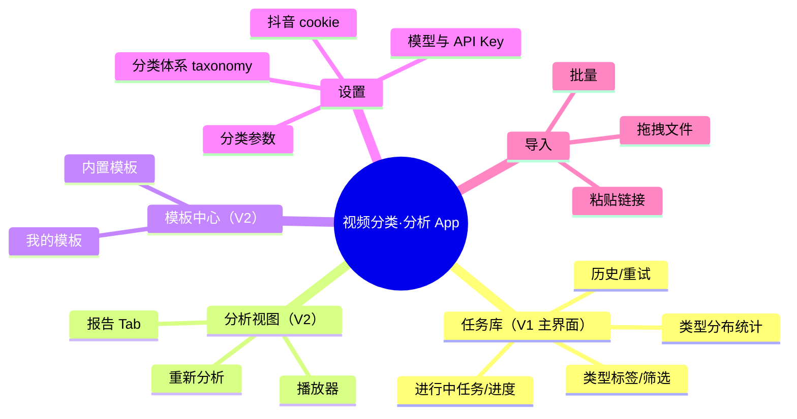

# 06 · UI 与交互设计

> 回答"UI 和交互如何做、什么时候做、先做功能还是先做界面"。

## 1. 时机与顺序（结论先行）

**先功能后界面，但流程设计先于界面开发**：

```
V1 Phase 0   CLI 验证分类准确率（无 UI）——确认 V1 核心价值立得住，避免界面返工的最大浪费
V1 Phase 0.5 低保真：任务库主界面 + 冻结 V1 契约（任务事件流 + taxonomy 数据结构）
V1 Phase 1   高保真关键屏与开发并行；界面严格按契约开发，管线侧改动不牵动前端
V2 Phase 3   分析视图的信息结构在 V2 开工前设计（依赖 spike 质量结论与报告 Schema 冻结）
持续         每阶段结束用真实使用反馈迭代（dogfooding）
```

为什么不先做界面：V1 的差异化在分类准确率与筛选效率，V2 在报告质量与自定义提示词，界面是交付载体；先冻结界面等于赌未验证的假设（例如 V2"观点树"若模型产出质量差就要降级为列表）。
为什么不最后做界面：契约冻结后界面与管线可并行，且"能用起来"才会产生真实迭代素材。

## 2. 信息架构

> **D58 修订（2026-10-03）：分析是产品主线。** 导航为 分析（首页：进行中分析 + 报告网格）｜素材库（导入+素材卡，分类弱化为角标与「开始分析」主按钮）｜设置。分类结果通过分析路由表（类型 → 提示词模板 + 模型档，D58）自动预填分析方案；分类详情（概率分布/10 帧预览）收入素材详情的「分类依据」折叠区。以下原始 mindmap 中「任务库」对应现在的素材库，「分析视图」升级为首页。




## 3. 页面明细（V1）

### 3.1 任务库（V1 主界面）
- **目的**：分类结果的中枢与主要消费场景，打开即见。
- 关键元素：缩略图网格（默认视图）；每卡：缩略图/标题/来源徽标 本地·抖音/类型标签（悬停显示置信度与 reason）/状态/耗时；工具栏：按类型、来源、有价值（taxonomy 标记）筛选 + 关键词；类型分布统计条（各类型数量占比）。
- 分类详情：点开单卡看完整判定（类型 + **概率分布条**（top-3 类型及概率）/ 置信度 / 中文证据摘要 summary_zh / **感知层 10 帧预览**（直接看模型"看到了什么"）/ 是否触发 L2 / 判定层（Jev / 降级·VLM 直出）/ other_guess）；支持手动改类型——记录改动供评测回归参考，不静默覆盖模型结果。
- 状态与空态：空库显示两张入口卡（拖入文件 / 粘贴链接）；失败卡片红点+失败阶段名+「重试本阶段」「查看错误」。
- **V2 追加**：no_value 卡片灰色标记"判定无分析价值（类型：舞蹈 · 理由一句话）"+「仍然分析」改判按钮（见文档 03 §3.0）。

### 3.2 分析视图（V2 核心页）
- **布局**：左右分栏。左侧播放器（`<video>` + 转写字幕条，当前句高亮）；右侧报告。
- **报告 Tab**：纪要（摘要+观点树）/ 章节（时间轴列表）/ 待办（可勾选）/ 金句/引用。所有带 `time` 的元素可点击 → 播放器 seek（V1 实现 seek，字幕联动 V1.5）。
- **操作**：重新分析（选模板/改指令，缓存命中时提示"转写复用，约1分钟"）；导出 Markdown/复制；切换模型对比。
- 空态/错误态：analyzing 阶段失败展示原始校验错误与重试按钮，不静默降级。

### 3.3 模板中心（V2）
- 内置模板卡片（通用总结/会议纪要/知识点提取/带货话术/求真核查）+ 新建。
- 编辑器：名称 + 指令文本 + 变量说明（`{{transcript}}` 等只读展示，模板只写指令层，系统层不可见——降低用户心智）。
- 分析发起页选模板时可见模板预览。

### 3.4 设置
- 分组：模型服务商（VLM provider 列表：base_url/api_key/默认模型，连接测试按钮；ASR 服务商单独一组：百炼默认/火山备选/**OSS 默认关闭、临时存储反复失败才手动开启**；**TypeSafe（Jev）单独一组：api_key + 决策层开关（默认自动降级并标记，可改为"仅报错"）**）、**门控分类体系**（类型列表编辑器：中文名 / **稳定键 name_en（Jev 与存储用，内置自带，留空回退中文并提示）** / 有价值开关 / 特征描述 hint（中文）/ hint_en（英文，发给 Jev），内置默认一键恢复；下方说明"改有价值标记即时生效，改类型列表对后续任务生效"）、分析参数（**V2**；简单档：画质/详细程度；高级档：兜底间隔/帧上限/无解说自动加密采样开关/**L2"快速模式"开关**）、**用量与预算**（本月各服务用量与花费估算、月度预算提醒线默认 ¥20 可调可关）、**数据**（库占用统计、本地文件"统一复制入库"开关、失效任务重链文件）、**隐私说明常驻**（明示会上传云端的内容：抽样帧、低置信时音频片段、平台元数据）、抖音（cookie 粘贴 + 有效性检测按钮 + 过期策略）。
- 密钥仅本地存储（keychain），界面永不回显完整密钥。

### 3.5 导入
- 全局拖拽（拖到窗口任意位置）；链接输入框自动识别抖音短链/分享口令；批量列表可逐条确认模板。
- **导入去重**：同 `file_hash` / 同抖音链接命中已有任务时提示"已分类过"并跳过（可点开原任务）；重跑走原任务的"重新分类"按钮。
- **时长硬校验（V2）**：发起**分析**时，超 20 分钟的文件/链接即拦截并给出明确文案（"超出分析时长上限 20 分钟"），不进分析队列、不消耗 API 额度。V1 分类不限时长。
- **导入边界提示**：纯音频文件拒绝（"仅支持视频文件"）、损坏文件明确报错（不可重试）；无音轨视频照常分类，无需提示。

### 3.6 首次启动引导（Onboarding）

- 触发：首启检测必需配置缺失 → 进入引导页；已配置完整（如升级安装）直接进主界面。
- 步骤 1：百炼 API Key（粘贴 + 连接测试按钮；说明免费额度与按量计费、月预算线）。
- 步骤 2：TypeSafe（Jev）Key——粘贴录入，或从 `.env.local` 导入（说明决策层可降级，未配也不阻塞 V1 使用）。
- 步骤 3：抖音 cookie（**可跳过**，"稍后在设置配置"，跳过时抖音导入入口置灰并提示）。
- 完成 → 放行导入，进入空任务库（两张入口卡）。

## 4. 关键交互模式

1. **阶段化进度**：进度条按阶段分段着色（V1：下载→探测→分类；V2 追加：转写→抽帧→分析），每阶段独立百分比与耗时；失败定位到具体阶段，重试只重跑该阶段（依赖缓存）。这是整个产品"可信感"的来源，优先级最高。
2. **失败透明**：错误信息=阶段+原因+一句人话解释；可展开原始日志；绝不静默吞错（与工程规范 fail fast 对齐）。
3. **缓存感知的重新分析**：明确告知哪些阶段复用了缓存，建立"改提示词很便宜"的心智，鼓励反复调优——这是自定义提示词卖点的体验支撑。
4. **时间锚点闭环（V2）**：报告 ↔ 播放器互跳，让"AI 说的每一句都能在视频里验证"，对冲幻觉焦虑。
5. **CSV 导出（V1）**：勾选导出 / 当前筛选结果全量导出；字段 9 列——文件名、来源 URL、`type`（name_en 稳定键）、类型显示名（中文）、top-3 类型及概率、置信度、判定层、分类时间、本地路径；UTF-8 带 BOM（Excel 中文兼容）。
6. **首次使用提示（V1）**：首次导入弹**一次性 toast**（"分类需将抽样帧上传云端模型，详见设置-隐私说明"），不做阻断式弹窗。
7. **后台运行（V1）**：批量任务进行中，最小化窗口=缩到系统托盘继续执行；全部完成后发一次系统通知（成功/失败计数）；不做开机自启。
8. **剪贴板链接检测（V1.5）**：复制抖音链接后切回 App，自动提示"检测到链接，导入？"（macOS 读剪贴板有隐私提示，V1 先用粘贴框）。

## 5. 视觉与文案

- V1 走工具风（参考 Cherry Studio / Chatbox 的信息密度与克制配色），浅/深色跟随系统；不追求品牌化视觉，把设计预算花在报告排版（观点树缩进、时间锚点样式、待办勾选）上。
- 文案规范：阶段名用户可读（"正在转写音频"而非 "asr"）；错误文案=发生了什么+怎么办；所有 AI 产物标注生成模型与模板（可追溯）。

## 6. 产出物清单（V1 Phase 0.5 交付）

1. 信息架构图 + 3 条核心流程低保真（导入→分类→筛选/查看判定；失败重试；taxonomy 编辑）
2. 高保真关键屏（任务库/设置）——Figma 或直接前端原型
3. 任务事件流契约 + taxonomy 数据结构评审（前后端一起过，签字冻结）
4. （V2 开工前追加）分析视图低保真 + 报告 Schema 评审

## 7. 设计工具（定稿，D55）

UI 设计与交互产出统一使用 **ui-ux-pro-max**（本机已安装的技能插件，含 design / design-system / ui-styling / brand 等子能力）完成：

- 适用范围：Phase 0.5 低保真流程图、Phase 1 高保真关键屏（任务库/设置）、视觉与文案规范（§5）、V2 分析视图与后续新增页面
- 使用方式：在支持该插件的设计/前端会话中调用产出，产出物仍按 §6 清单验收（工具不改变验收标准）
- 设计系统：Phase 1 高保真阶段用其 design-system 能力定一套轻量设计 token（色板/字号/间距/深浅色），前端直接消费，避免各页面样式漂移
